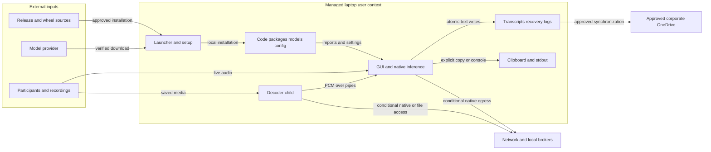

# Meeting Scribe: current repository threat model

Reviewed 2026-10-12 against branch `main`, commit `7e7d933699dcd8bdf477d368d0514950d808770c`. Method: offline, read-only source review with independent runtime and setup/distribution reviews. No application execution, exploit reproduction, dependency CVE assessment, or managed Codex Security scan was performed.

## Executive summary

Meeting Scribe processes confidential meetings as the signed-in Windows user. Current setup verifies locked wheels and pinned model downloads, and saved-media decoding now uses a separate process. Remaining priorities are reliable decoder containment, operating-system enforcement of runtime egress, and approved release/build provenance. Two concrete control gaps qualify the documented guarantees: decoding proceeds when Windows Job Object attachment fails, and the recording-path check does not exclude ordinary UNC paths. Neither a native-parser exploit nor a compromised dependency was established. Model reuse, native inference, plaintext outputs, and approved OneDrive sharing remain dependent on endpoint controls and directory permissions. Evidence: `app/file_transcriber.py:91`, `app/win_job.py:47`, `app/audio_decode_worker.py:22`, `app/offline_guard.py:8`.

The rest of this report describes the code as reviewed at `7e7d933`, so its line references point at that commit. The next section records what changed afterwards. It replaces an earlier review of `234bd5c`; that review's fixes are in commits `9bd2eed` to `d407fe8`.

## Remediation status

Updated 2026-10-12 after commits `ae06e8f` to the commit that added this section. The threat analysis below is unchanged.

| Threat | Status | Changed in the app | Still needs a control outside the app |
|---|---|---|---|
| TM-001 Supply-chain execution | Partly fixed | Setup installs only hash-locked wheels (`--require-hashes --only-binary=:all: --no-deps`). The portable build now uses the same rules, through `resources/requirements-build.lock.txt` (PyInstaller and its dependencies), and bundles `resources/` with the locks and model manifest (`80ad1d1`). The README publishes the launcher SHA-256. | The launcher and portable EXE are not code-signed: use an approved distribution channel and check the published hash. Lock and manifest changes need review, because they record what upstream served. PyInstaller itself was not run to verify the new build script. |
| TM-002 Egress after compromise | Partly fixed | The engine's offline step now installs the Python socket guard as well as the offline flags, so engine and model loads are guarded even without the launcher (`ae06e8f`). The UDP guard and the decoder child's `file`-only FFmpeg protocols remain. | Native code, other processes and removed hooks are outside the Python guard. Recommended: an IT outbound rule for the runtime `pythonw.exe` and the portable EXE (which is also the decoder). |
| TM-003 Native parser compromise | Deferred, documented | Process separation, Job Object limits (now fail-closed, see TM-008), `file` protocol only, and a 120 s idle timeout. | The decoder runs with the user's file access; AppContainer or restricted-token isolation was deferred because it needs ACL grants to Python, packages and each chosen file. Model parsing stays in the GUI process; TM-004 now checks setup-managed models before parsing. |
| TM-004 Model/package substitution | Fixed for setup-managed models | `load_whisper_model` re-hashes a setup-managed model folder against `resources/model_manifest.json` on every fresh load, before any model code reads the files. A changed or missing file is refused with a "run setup" message. Measured cost: about 1.5 s for the 1.5 GB CPU model and about 1 s for the 0.83 GB GPU model (`b2e12fc`). | Not covered: the OpenVINO `.ov_cache` compiled blobs, custom model folders (logged as unverified), and installed packages (the module probe checks presence, not hashes). These depend on Windows folder permissions. |
| TM-005 Availability | Fixed for Stop | Stop still transcribes queued audio, but only for up to 60 s. The rest is drained untranscribed and reported as a warning with the seconds skipped. The chunk in progress always finishes, so Stop waits at most about 60 s plus one chunk (`ae40331`). Live queues stay bounded at 30 minutes. | A single native inference call still has no hard deadline. |
| TM-006 Unintended text disclosure | Fixed in app; policy remains | Live transcript text is no longer printed to stdout (`ae06e8f`). Text goes only to the window, transcript and recovery files, and the clipboard on an explicit Copy. | OneDrive sharing, recovery-file retention, and clipboard history or cloud clipboard policy. |
| TM-007 Destination misuse | Accepted | Unchanged: type-checked config, source/output separation, atomic writes. | Protect the config and install folders; constrain destinations by policy if required. |
| TM-008 Decoder containment failure | Fixed | On Windows, if the decoder cannot be placed in its Job Object, it is stopped before it receives the start byte, so the recording is never opened. The error says why (`ae06e8f`). Existing real-decode tests confirm the job attaches on the target laptop. | Record job failures through endpoint telemetry if wanted. |
| TM-009 Remote filesystem paths | Accepted by the user, documented | Network shares stay allowed for recordings, models and outputs. The README states that Windows reads them through file sharing, outside the Python guard. | IT decides whether SMB from these processes is allowed. |

Other items from the notes below:
- **Model-size lookup token:** the setup lookup now passes `token=False` (`ae06e8f`).
- **README:** corrected for the decoder limits, network shares, `preprocessor_config.json` and on-demand model start.
- **Portable bundle:** it now includes `resources/`.

## Scope and assumptions

- **User-confirmed:** company-managed Windows 11 laptops; one standard user; confidential meetings; approved corporate OneDrive; no network service; malicious media, dependencies, and models in scope.
- **User-confirmed unknown:** whether IT enforces outbound blocking for both the application and decoder, including native libraries and Windows file-share traffic. This report does not assume such enforcement exists or is absent.
- **In scope:** current `app/`, `resources/`, `Open Offline Meeting Transcriber.pyw`, and `packaging/`; live capture, saved recordings, setup/upgrades, local persistence, and the documented portable distribution path.
- **Out of scope:** Windows, OneDrive, GPU-driver and upstream-library implementation audits; comprehensive dependency vulnerability research; company identity, DLP and retention administration; participant-consent policy. Tests are supporting evidence, not deployed entry points. No repository CI workflow was found.
- **Trust assumptions:** the Python installation, process environment, approved release channel, lock/manifest approvers, and install-directory writers are trusted unless a scenario explicitly crosses one of those boundaries. Same-user malware does not acquire new privileges merely by changing its own configuration.

Open questions that materially change priority:

1. What endpoint rules cover Python/native networking, loopback brokers, the decoder executable, and OS-mediated SMB access?
2. Who can write the launcher, extracted application, private/shared runtime packages, models, compilation cache, configuration, and transcript folders? Are writable OneDrive shares used for executable content?
3. Are UNC paths or mapped network drives intended inputs or destinations? A file protocol restriction does not establish that a Windows file resides on a local volume.
4. How are launcher hashes, wheel locks, model revisions, custom models, and portable releases approved? Is the portable executable signed and its dependency set verified?
5. Are clipboard history, cloud clipboard, source-mode stdout capture, and recovery-file retention permitted for confidential text?

## System model

### Primary components

| Component | Role and effective resources | Evidence |
|---|---|---|
| Standalone launcher | Extracts embedded `app/` and `resources/` next to the launcher under `OfflineMeetingTranscriber`, unless `--install-root` is supplied. Checks payload/file hashes and resolved extraction containment; preserves existing configuration and unrelated files. | `packaging/build_standalone_pyw.py:77`, `:84`, `:92`, `:124`, `:147` |
| Bootstrap/setup | Tkinter installation consent; private pip target; backend selection; pinned model staging, digest checks and rollback. Installs packages beneath `%LOCALAPPDATA%/OfflineMeetingTranscriberRuntime/site-packages` for OneDrive roots, otherwise `<app root>/.runtime/site-packages`; `LOCAL_WHISPER_RUNTIME_ROOT` overrides this. | `app/bootstrap_launcher.py:528`, `:1113`, `:1725`, `:1828`, `:3187` |
| Desktop GUI/live engine | PySide6 actions, microphone/WASAPI capture and transcription threads. Source-mode app data defaults to `%USERPROFILE%/Apps/OfflineMeetingTranscriber`, with `LOCAL_WHISPER_APP_ROOT` override. | `app/meeting_transcriber_gui.py:168`, `:670`; `app/transcriber_engine.py:692`, `:738`; `app/app_config.py:37` |
| Saved-media decoder | Separate Python process, or portable executable in `--decode-worker` mode; PyAV/FFmpeg converts a file to 16 kHz mono float32 PCM over pipes. Requested Job Object limits are 2 GiB memory, one active process and termination when the job closes. | `app/file_transcriber.py:24`, `:72`, `:91`; `app/audio_decode_worker.py:52`; `app/win_job.py:47` |
| Native inference | faster-whisper/CTranslate2 or OpenVINO GenAI executes in the GUI process. CPU loading uses `local_files_only=True`; OpenVINO writes `.ov_cache` inside the selected model folder. The decoder's job does not protect inference. | `app/transcriber_engine.py:543`, `:560`, `:1321`; `app/file_transcriber.py:255` |
| Persistence/export | JSON config; models and approval marker; plaintext transcripts and recovery files; diagnostic logs; explicit clipboard export. Default outputs stay beneath the selected application root and can therefore be in approved OneDrive. | `app/app_config.py:69`, `:91`, `:144`, `:159`; `app/transcriber_engine.py:602`; `app/meeting_transcriber_gui.py:781` |
| Build/release tooling | Standalone generator embeds source/resources and updates README checksum. Separate PowerShell/PyInstaller path installs build requirements and emits an unsigned `onedir` bundle. These are trusted developer workflows, not runtime services. | `packaging/build_standalone_pyw.py:31`, `:179`, `:189`; `packaging/build_portable.ps1:23`; `packaging/local_whisper_transcriber.spec:47` |

### Data flows and trust boundaries

- **B1: Release/build inputs -> executable application.** Python code, wheels and native binaries cross local distribution boundaries. Embedded SHA-256 and extraction containment detect corruption or unsafe paths relative to a trusted launcher; they do not authenticate a replaced launcher. Portable dependency installation has fewer restrictions than setup. Evidence: `packaging/build_standalone_pyw.py:84`, `:102`; `packaging/build_portable.ps1:23`.
- **B2: PyPI/Hugging Face -> consented setup -> private packages/models.** Downloads cross HTTPS. TLS uses Windows truststore, optional local CA files and existing certificate environment settings. pip enforces `--require-hashes --only-binary=:all: --no-deps`; models use a manifest-pinned commit and staged SHA-256 checks. Snapshot downloads explicitly suppress cached tokens with `token=False`; the model-size metadata request does not explicitly suppress them. These integrity controls depend on trusted lock/manifest approval. Evidence: `app/bootstrap_launcher.py:528`, `:657`, `:1506`, `:1585`, `:1784`, `:1885`.
- **B3: Meeting participants/devices -> live capture and inference.** Audio enters through microphone/WASAPI APIs and is processed by native libraries and Python threads under the user's authority. Capture parameters and model completeness are checked; queues are bounded and oldest queued audio is skipped with a warning when backlog fills. No participant authentication or sandbox is supplied by the transcription engine. Evidence: `app/transcriber_engine.py:324`, `:676`, `:738`, `:1060`.
- **B4: Selected recording -> decoder process -> GUI inference.** Media bytes cross a native-parser boundary. The parent uses argument-list subprocess execution and a stdin gate; FFmpeg is restricted to `file`; PCM is streamed through an eight-block parent queue. Decoder inactivity stops the process after 120 seconds. Job creation/attachment can return `None`, yet the parent releases the gate; successful containment is not a prerequisite. A job does not restrict filesystem privileges or native networking. Evidence: `app/file_transcriber.py:72`, `:90`, `:95`, `:140`; `app/audio_decode_worker.py:22`, `:52`, `:74`; `app/win_job.py:47`.
- **B5: Local configuration/models/packages -> runtime behavior.** JSON accepts recognized configuration fields, checks basic types, anchors relative paths to the app root and falls back on invalid configuration. Absolute destinations remain allowed. Package reuse checks module availability/minimum versions, not lock hashes. An approved model revision marker bypasses rehash; custom model folders bypass default approval. Windows permissions supply the writer boundary. Evidence: `app/app_config.py:91`, `:118`; `app/bootstrap_launcher.py:1172`, `:1443`; `app/transcriber_engine.py:1321`.
- **B6: Runtime -> network/local services/remote filesystem.** Bootstrap installs Python socket hooks before GUI imports; hooks block non-loopback Python TCP/DNS/UDP and force offline environment flags. Native APIs, other processes and deliberate removal remain outside that policy. Direct source GUI launch installs hooks in `main()` after imports; using the engine alone forces flags without installing socket hooks. UNC/mapped-drive access goes through OS filesystem services, not this Python socket boundary. Evidence: `app/offline_guard.py:8`, `:37`, `:95`, `:108`; `app/bootstrap_launcher.py:1960`; `app/meeting_transcriber_gui.py:35`, `:971`; `app/transcriber_engine.py:286`, `:692`; `app/audio_decode_worker.py:22`.
- **B7: Runtime -> transcript/recovery files, clipboard and approved OneDrive.** Text crosses filesystem and clipboard APIs. Same-directory temporary files plus `os.replace` protect write completeness; live filenames include timestamps; saved-file jobs reject resolved source/output equality. These controls do not enforce reader authorization, encryption, sharing or retention. Live text also goes to stdout in the transcription loop. OneDrive synchronization is an approved external workflow, not an application upload. Evidence: `app/transcriber_engine.py:602`, `:637`, `:1208`; `app/meeting_transcriber_gui.py:108`, `:717`, `:781`; `app/file_transcriber.py:247`.

#### Diagram

## Assets and security objectives

| Asset | Why it matters | Security objective (C/I/A) |
|---|---|---|
| Audio, transcripts, recovery files and approved synced copies | Confidential corporate discussion and participant information | C/I; preserve authorized access and accurate output |
| Standard-user account and accessible company files | Native or imported code inherits this authority | C/I; prevent lower-trust inputs from gaining user-context execution |
| Launcher, wheel locks, private packages, models and cache | Determine executable behavior and transcript correctness | I; authenticate approval and prevent untrusted writers |
| Configuration, output destinations and TLS trust inputs | Determine where code, data and downloads are consumed | C/I; protect operator-controlled settings and effective paths |
| CPU/GPU, memory, disk and capture continuity | Transcription shares the meeting laptop's resources | A/I; bound work, support cancellation and report skipped audio |
| Clipboard, stdout and diagnostics | Additional recipients or retained copies can expose meeting context | C; make text export intentional and govern retention |

## Attacker model

### Capabilities

- A meeting participant or sender can supply speech or a recording that the user chooses to process, including crafted native-parser input.
- A distribution attacker can offer a replaced launcher or portable bundle; successful execution requires the user to trust and launch it. An upstream compromise can enter a subsequently approved lock/model revision.
- A lower-trust collaborator or transferred installation can conditionally supply files later imported or loaded if it has write access to the relevant installation, package or model location. That access is not assumed merely because transcripts are shared.
- After an independently established code-execution path, malicious code can use the standard user's existing file/native-API authority. Egress then depends on endpoint policy rather than Python hooks.

### Non-capabilities

- No assumed remote listener, tenant boundary, administrator privilege, kernel compromise, or permission to arbitrary corporate OneDrive folders.
- Recording bytes do not themselves confer configuration or filesystem write access. Model data is not assumed to execute Python inherently.
- No specific exploitable decoder, inference-library vulnerability, compromised wheel, live credential leak, or actual job-attachment failure was demonstrated.
- Ordinary authorized save/copy, approved OneDrive synchronization and same-user configuration edits are not authorization bypasses. Build arguments and local CA selection are operator/developer inputs unless an attacker controls their source location.

## Entry points and attack surfaces

| Surface | How reached | Trust boundary | Notes | Evidence (repo path / symbol) |
|---|---|---|---|---|
| Standalone launcher and `--install-root` | Double-click or CLI | B1/B5 | Executable distribution; extraction containment; existing extra files retained | `packaging/build_standalone_pyw.py:92`, `:124`, `:140` |
| Setup, upgrade and package probe | Startup checks and Install action | B2/B5 | Downloads are consented; installed-module probe precedes runtime guard and preserves `PYTHONPATH` | `app/bootstrap_launcher.py:1172`, `:2190`, `:3187` |
| TLS and model metadata requests | Online setup | B2 | Corporate trust inputs; metadata token suppression is an open question | `app/bootstrap_launcher.py:657`, `:1506`, `:1585` |
| Saved recording / decoder worker | GUI selection or portable worker mode | B4/B6 | Native media parsing; filesystem path checks; conditional job limits | `app/meeting_transcriber_gui.py:704`; `app/audio_decode_worker.py:22`; `app/bootstrap_launcher.py:3248` |
| Live audio | Record action and selected devices | B3 | Bounded queues; native inference has no hard deadline | `app/transcriber_engine.py:676`, `:738`, `:1186` |
| Config, model and compilation cache | Config file or Advanced settings | B5 | Presence/type validation; custom and reused models require writer controls | `app/app_config.py:91`; `app/bootstrap_launcher.py:1459`; `app/transcriber_engine.py:560` |
| Source-mode GUI / engine API | Documented developer invocation or caller import | B5/B6 | Offline enforcement starts at different points | `app/meeting_transcriber_gui.py:35`, `:971`; `app/transcriber_engine.py:692` |
| Output, recovery, clipboard and stdout | Save/Copy or transcription progress | B7 | Plaintext; atomic writes; explicit clipboard action | `app/transcriber_engine.py:618`, `:637`, `:1208`; `app/meeting_transcriber_gui.py:781` |
| Lock generators and portable build | Developer invocation | B1/B2 | Trusted approval path; portable dependencies are not hash-locked | `packaging/lock_requirements.py:46`; `packaging/lock_models.py:35`; `packaging/build_portable.ps1:23` |

## Top abuse paths

These are threat scenarios, not confirmed vulnerability findings. Existing TM-001 through TM-007 retain their earlier themes; TM-008 and TM-009 identify distinct current controls.

1. **TM-001 — Supply-chain execution:** (1) replace an executable release or compromise code before dependency approval; (2) the operator launches or approves it; (3) imports/native binaries gain the user's company-data access. Download hash substitution against an unchanged approved lock is blocked.
2. **TM-002 — Egress after compromise:** (1) obtain execution through a separate supply-chain or parser failure; (2) read confidential state; (3) use native APIs or a local broker outside Python hooks. Exfiltration is conditional on unknown IT egress controls.
3. **TM-003 — Native parser compromise:** (1) send crafted media or model data; (2) the user processes it; (3) exploit an otherwise-unproven native parser bug. Decoder process separation contains ordinary crashes but does not remove the user's filesystem authority; model parsing remains in the GUI process.
4. **TM-004 — Model/package substitution after approval:** (1) obtain meaningful lower-trust write access or supply a transferred installation; (2) alter reused packages, model files or cache; (3) presence checks or an unchanged revision marker permit later loading. Transcript manipulation is plausible; parser code execution remains conditional.
5. **TM-005 — Availability and transcript completeness:** (1) supply expensive input or sustained audio while inference cannot keep up; (2) native work stalls or backlog fills; (3) shutdown waits or oldest audio is skipped. Queue exhaustion is mitigated; no hard native-inference deadline exists.
6. **TM-006 — Unintended text disclosure:** (1) broaden sharing or retain clipboard/stdout/recovery text outside approved policy; (2) an unintended reader obtains confidential content. Approved OneDrive use alone is not a vulnerability.
7. **TM-007 — Destination misuse:** (1) obtain write access to another user's consumed configuration or persuade an operator to choose an inappropriate destination; (2) direct plaintext output to that location; (3) disclose or replace a user-writable file. Atomic replacement does not authorize destinations; no privilege escalation is shown.
8. **TM-008 — Decoder containment failure:** (1) the user opens malicious or expensive media; (2) Windows job creation/configuration/attachment fails; (3) `contain_process` returns `None` but the parent sends the start byte; (4) decoding runs without the intended job memory/process limits. Failure behavior is source-confirmed; its occurrence on deployed laptops is unmeasured.
9. **TM-009 — Remote filesystem bypass of local-only policy:** (1) an accessible UNC or mapped-share path is selected or configured; (2) file checks and the `file` protocol allow OS-mediated access; (3) remote file traffic occurs without passing Python socket hooks. Arbitrary media-driven remote references or credential theft were not demonstrated.

## Threat model table

Priorities rank source-backed scenarios under the confirmed deployment, not validated exploit severity. Medium priorities identify practical review/control work; low priorities need stronger attacker access or additional failures. No critical or high exploit was established.

| Threat ID | Threat source | Prerequisites | Threat action | Impact | Impacted assets | Existing controls (evidence) | Gaps | Recommended mitigations | Detection ideas | Likelihood | Impact severity | Priority |
|---|---|---|---|---|---|---|---|---|---|---|---|---|
| TM-001 | Release/upstream/build attacker | User executes a replaced release or approves compromised build input. | Introduce executable code. | Standard-user execution and potential company-data theft. | Code, account, meetings | Embedded hashes/containment (`packaging/build_standalone_pyw.py:84`); locked wheels (`app/bootstrap_launcher.py:528`); pinned model digests (`:1885`). | No independent launcher authenticity; portable install is unhashed; approved malicious content can still match hashes. | Distribute through an approved authenticated channel; independently publish approved hashes; hash-lock portable build dependencies; review lock/model changes. | Approved package/release inventory and endpoint module-origin alerts. | Medium: installation is routine; compromise or distribution deception is required. | High: executable code inherits company-data access. | medium |
| TM-002 | Compromised runtime | Separate code execution plus permitted outbound path. | Use native networking or an authorized local broker. | Conditional exfiltration of confidential data. | Audio, text, account files | Python TCP/DNS/UDP hooks and offline flags (`app/offline_guard.py:95`, `:108`). | Hooks are removable and do not contain native/OS traffic; IT rules unknown. | Verify IT enforcement for actual runtime/decoder identities and local brokers; distinguish approved sync from app egress. | Endpoint telemetry for unexpected runtime destinations and descendants. | Low: another compromise is required; endpoint policy may block it. | High if outbound exfiltration succeeds. | low |
| TM-003 | Malicious media/model sender | User processing plus an exploitable native parser bug, not established here. | Trigger decoder/inference memory-safety failure. | Crash or conditional user-context execution. | User files, meeting data, availability | Separate media decoder; `file` whitelist; 120-second idle timeout (`app/file_transcriber.py:140`; `app/audio_decode_worker.py:52`). | No restricted user token/filesystem sandbox; inference shares GUI authority. | Assess decoder restricted-token/AppContainer isolation; keep parser dependencies approved and current; isolate inference where feasible. | Decoder crash/exit and endpoint exploit-protection telemetry. | Low: untrusted parsing is real; exploitability is unproved. | High if execution occurs; otherwise bounded availability loss. | low |
| TM-004 | Lower-trust file writer / transferred install | Write access to files consumed by a different trust context. Same-user edits alone are not a finding. | Change reused code, model/cache or approval marker. | Integrity loss; conditional native/parser execution. | Packages, models, transcripts | Download hashes; legacy one-time verification (`app/bootstrap_launcher.py:1419`, `:1463`); required-file checks (`app/transcriber_engine.py:38`). | Approved marker skips rehash (`app/bootstrap_launcher.py:1460`); package probe is not integrity verification (`:1172`); custom models bypass approval. | Protect executable/model directories from lower-trust writers; verify models before load or use protected verification state; define custom-model approval. | Approved-file drift checks, source/revision inventory and effective ACL review. | Low under single-user protected directories; rises with shared writers. | High for code/parser compromise; medium for transcription integrity. | low |
| TM-005 | Expensive input / sustained audio | User starts processing; native work is costly or stalls. | Consume inference resources or outpace capture. | Stalled completion and skipped audio. | Meeting continuity, CPU/GPU/RAM, transcript completeness | Bounded queues and skip warnings (`app/transcriber_engine.py:676`, `:1060`); decoder streaming/deadline (`app/file_transcriber.py:90`, `:140`). | Native inference/cancellation has no hard deadline; `stop` joins without timeout (`app/transcriber_engine.py:714`). | Use cancellable inference processes with deadlines if availability requirements warrant it; preserve visible skipped-audio accounting. | Inference duration, cancellation latency and skipped-seconds metrics without text. | Medium: long sessions and slow inference are realistic; pathological hangs are unverified. | Medium: local transcription/meeting availability, not a shared service. | medium |
| TM-006 | Unintended recipient / workflow error | Text crosses an unapproved sharing, clipboard or retention boundary. | Read exported/retained plaintext. | Confidential discussion disclosure. | Text, recovery files, clipboard/stdout | Approved OneDrive policy; explicit Copy (`app/meeting_transcriber_gui.py:781`); normal error callers omit transcript payloads (`:908`). | Plaintext outputs and live stdout (`app/transcriber_engine.py:1208`); effective readers/retention unknown. | Apply approved DLP/sharing and recovery retention; make console transcript export opt-in where required; govern clipboard history. | Enterprise sharing/clipboard controls and output-access audit. | Low under confirmed approved storage; policy mistakes remain possible. | High for confidential meeting content, depending on actual recipient. | low |
| TM-007 | Config writer / destination deception | Another trust context writes consumed config, or operator chooses an inappropriate destination. | Redirect or replace output. | Disclosure or user-writable file damage. | Config, transcript destinations | Config type checks (`app/app_config.py:118`); source/output equality checks (`app/file_transcriber.py:247`); atomic writes (`app/transcriber_engine.py:637`). | Absolute paths and inherited permissions remain allowed. | Protect config; constrain destinations to approved roots when required; enforce local-volume policy separately. | Record destination paths without text; review config changes. | Low: operator selection or cross-context write access required. | Medium: damage limited to user's permitted destinations. | low |
| TM-008 | Malicious/expensive media sender | User processes media and Windows job attachment fails. | Continue native decoding without intended limits. | Unbounded decoder resource use; loss of descendant restriction. | RAM, processes, capture availability | Requested memory/process/kill-on-close flags (`app/win_job.py:61`); PCM queue and idle timeout (`app/file_transcriber.py:90`, `:140`). | Failure returns `None` (`app/win_job.py:57`, `:72`) but parent sends start byte (`app/file_transcriber.py:95`). | On Windows, reject decoding when containment returns `None`; report actionable error before releasing stdin gate. Do not describe a successful job as a full sandbox. | Record job-attachment success/failure and decoder peak memory. | Medium conditional: failure handling is certain; deployment failure frequency is unknown. | Medium: intended process/resource protections disappear; execution still requires a separate exploit. | medium |
| TM-009 | Path supplier / remote filesystem host | User selects/configures an accessible UNC or mapped share; IT permits that traffic. | Cause OS remote-file access under a local-only promise. | Offline-policy violation and remote host interaction. | Network policy, media/output confidentiality | URL/device rejection and regular-file check (`app/audio_decode_worker.py:22`); FFmpeg `file` whitelist (`:58`). | No UNC/local-volume enforcement; hooks do not mediate SMB. | Decide whether shares are supported; if not, reject UNC and mapped remote volumes for input/model/output and validate resolved volume location. | Endpoint SMB telemetry and effective path/volume classification. | Low: remote paths must be selected or configured; malicious nested references are unproved. | Medium: policy loss; actual content or credential disclosure is not established. | low |

## Criticality calibration

- **Critical:** a demonstrated attacker-controlled path that reliably executes code without meaningful user approval across the intended deployment; or a verified compromise of the authenticated release channel distributing attacker code broadly with confidential-data exfiltration. Neither is established. A missing signature, hypothetical parser CVE, or removable Python hook alone is not critical.
- **High:** a proven exploit from a routinely received meeting recording into standard-user code execution; or demonstrated lower-trust shared-directory substitution that executes code for many users despite required approval checks. Endpoint containment and a lack of writable cross-user paths can lower these scenarios.
- **Medium:** decoding continues after job attachment fails, removing intended availability/process protections; inference stalls or sustained overload prevents timely completion; a supported portable release is shown to include unapproved build inputs. Current TM-001, TM-005 and TM-008 are review priorities, not proof that these deployed outcomes occurred.
- **Low:** approved OneDrive/explicit clipboard workflows with no unauthorized recipient demonstrated; writable custom models or output paths controlled only by the same user; conditional native egress that first requires an independent compromise. These rise if concrete lower-trust writer access, unintended readers, exploitable inputs or unblocked exfiltration are established.

Confidence is separate from impact. The fail-open branch, marker-based reuse and absent UNC rejection are directly visible in source; their deployment frequency and exploit consequences are not. No installed-library vulnerabilities or live endpoint configurations were tested.

## Focus paths for security review

| Path | Why it matters | Related Threat IDs |
|---|---|---|
| `app/file_transcriber.py` | Enforces decoder gate, pipes, deadlines, cancellation and parent-side buffers. | TM-003, TM-005, TM-008 |
| `app/win_job.py` | Windows job attachment/failure semantics decide whether requested limits exist. | TM-003, TM-008 |
| `app/audio_decode_worker.py` | Recording validation and native `file` parsing establish local/remote filesystem boundary. | TM-003, TM-009 |
| `app/offline_guard.py` | Python-only egress policy, loopback permissions and native/OS limits. | TM-002, TM-009 |
| `app/bootstrap_launcher.py` | Effective runtime paths, package probe, online consent, TLS, model verification/reuse and runtime transition. | TM-001, TM-002, TM-004, TM-009 |
| `app/transcriber_engine.py` | Native model loading/cache, backlog, inference shutdown, atomic/recovery writes and stdout export. | TM-003, TM-004, TM-005, TM-006, TM-007 |
| `app/app_config.py` | Resolves model/output/log roots and accepts absolute destinations. | TM-004, TM-006, TM-007, TM-009 |
| `app/meeting_transcriber_gui.py` | User approval, model selection, source/output separation, text rendering and clipboard boundary. | TM-003, TM-004, TM-006, TM-007 |
| `Open Offline Meeting Transcriber.pyw` and `packaging/build_standalone_pyw.py` | Executable release authenticity, safe extraction, retained files and embedded-source parity. | TM-001, TM-004 |
| `resources/requirements.lock.txt`, `resources/requirements-openvino.lock.txt` | Define approved direct/transitive wheel bytes for consented setup. | TM-001 |
| `resources/model_manifest.json` and `packaging/lock_models.py` | Define model provenance/approval and native-parser input digests. | TM-001, TM-003, TM-004 |
| `packaging/build_portable.ps1`, `packaging/local_whisper_transcriber.spec`, `resources/requirements-build.txt` | Portable build trust, signing and parity with stronger standalone setup. | TM-001, TM-004 |

## Notes on use

- **Immediate control work:** make Windows decoder containment fail closed; establish IT-owned runtime/decoder/native/SMB egress policy; verify approved distribution and portable build provenance. These recommendations are concrete proposals, not code changes made by this review.
- **Documentation reconciliation:** `docs/threat-model.md` preserves an older baseline plus a remediation appendix. Its historical sections still describe in-process media decoding, unbounded queues and earlier dependency/network controls; use this document's current source anchors when assessing present behavior. README's unconditional decoder-limit and local-file claims need the qualifications above.
- **Additional unresolved checks:** `app/bootstrap_launcher.py:657` omits `token=False` for model-size metadata while snapshot downloads set it at `:1792`; cached-token transmission was not established. `packaging/local_whisper_transcriber.spec:11` starts with no application resource data, and `packaging/build_portable.ps1:39` copies config/docs rather than locks/model manifest; no built bundle was inspected, so resource parity remains unverified. Missing approved model manifests fail closed at `app/bootstrap_launcher.py:1403`.
- **Smaller documentation differences:** README lists `preprocessor_config.json` as required for CPU models, while completeness validation at `app/transcriber_engine.py:24` does not include it. The normal error-log path does not deliberately log transcript rows, but live transcription prints them at `:1208`; blanket statements about all logs/outputs should distinguish stdout.
- **Verification:** static AST/literal decoding checked all 17 embedded payload files against current source after LF normalization. Compressed payload and per-file digests matched; launcher SHA-256 matched the published README value. Repository citations were checked against current files. No application imports, test execution, downloads or exploit-triggering inputs were used.
- **Coverage quality check:** discovered launcher/setup/GUI/live-media/decoder/model/config/output/build entry points covered; B1–B7 represented in scenarios; runtime separated from trusted build/developer workflows; user clarifications incorporated; unverified deployment and dependency behavior retained as questions. This is an architecture/threat model, not a claim of exhaustive source-audit coverage.
- **Workflow limitation:** required Codex Security scan MCP tools were unavailable, so no managed scan or plugin scan findings were produced. This standalone document fulfills the explicitly requested local `security-threat-model` workflow.

Repository: local-whisper-transcriber
Version: 7e7d933699dcd8bdf477d368d0514950d808770c
