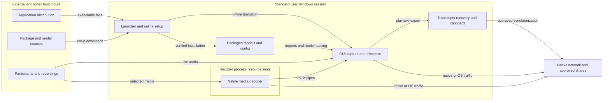

# Meeting Scribe threat model

Reviewed on 2026-10-23 against branch `main`, commit `450335f2aed10c7fb62bdb898928adab096874d6`, with the managed-model checks from that commit. Method: local static source review and non-executing validation of the standalone launcher's embedded payload. This is a threat model, not a vulnerability scan or a claim that the attack scenarios have been reproduced. Line references point at `450335f`. The next section records what changed afterwards. This review replaces the earlier one of `7e7d933`, whose TM-008 and TM-009 are mapped below.

## Remediation status

Updated 2026-10-23, after the review. The threat analysis below describes `450335f`.

| Threat | Status | Changed in the app | Still needs a control outside the app |
|---|---|---|---|
| TM-001 Redistributed or supply-chain code | Partly fixed | Setup installs only hash-locked wheels (`--require-hashes --only-binary=:all: --no-deps`). The portable build uses the same rules through `resources/requirements-build.lock.txt` and bundles `resources/` with the locks and model manifest (`80ad1d1`). The README publishes the launcher SHA-256. | The launcher and portable EXE are not code-signed: use an approved distribution channel and check the published hash through a separate trusted source. Lock and manifest changes need review, because they record what upstream served. |
| TM-002 Egress after compromise | Partly fixed | The engine installs the Python socket guard as well as the offline flags (`ae06e8f`). The README no longer promises that the app never uses the network: it states that Python network calls are blocked and that native libraries and network-share paths are outside the block (2026-10-23). | The user confirmed IT does not block outbound traffic. Recommended: an IT outbound rule for the runtime `pythonw.exe` and the portable EXE (which is also the decoder), separating approved setup and SMB workflows. |
| TM-003 Native parser compromise | Deferred, documented | Process separation, Job Object limits that fail closed (earlier TM-008), `file` protocol only, a 120 s idle timeout, and approved-model checks before parsing. | The decoder runs with the user's file access; AppContainer or restricted-token isolation was deferred because it needs ACL grants to Python, packages and each chosen file. Inference stays in the GUI process. |
| TM-004 Resource substitution | Fixed for setup-managed models | `load_whisper_model` re-hashes a setup-managed model folder against `resources/model_manifest.json` on every fresh load, before any model code reads the files. "Setup-managed" means `models/faster-whisper` or `models/openvino-whisper` under the app root, decided by location (`managed_model_repo` in `app/model_integrity.py`), not by `MODEL_SOURCE.json`. A missing, unreadable or foreign marker, a different revision, or a changed or missing file is refused with a "run setup" message, and setup offers only a digest-checked re-download (`450335f`). Path aliases (2026-10-23): at `450335f` a junction or link placed at a setup folder resolved to another path, so the folder counted as custom and loaded unverified. The location check now matches the plain path, the resolved path of both sides, and `os.path.samefile`, and tests cover a real junction. | Not covered: the OpenVINO `.ov_cache` compiled blobs, custom model folders (loaded and logged as unverified; anyone who can edit `config.json` can choose one), and installed packages (the module probe checks presence, not hashes). These depend on Windows folder permissions. No in-app fix is possible without a baseline the same writer cannot change. Setup trusts a marker with the approved revision without re-hashing at launch; the engine still re-hashes before load, so a tampered folder fails closed but setup does not offer repair. |
| TM-005 Availability | Fixed for Stop backlog | Stop transcribes queued audio for up to 60 s, then drains the rest untranscribed and reports the seconds skipped (`ae40331`). Live queues stay bounded. | A single native inference call has no hard deadline. `stop` joins its threads without a timeout, and the window refuses to close while Stop is waiting, so a hung native call would block both. No such hang has been observed. |
| TM-006 Unintended text disclosure | Fixed in app; policy remains | Live transcript text is not printed to stdout (`ae06e8f`). Text goes only to the window, transcript and recovery files, and the clipboard on an explicit Copy. | OneDrive sharing, recovery-file retention, and clipboard history or cloud clipboard policy. |
| TM-007 Destination misuse | Accepted | Type-checked config, source/output separation, atomic writes. | Protect the config and install folders; constrain destinations by policy if required. |
| Earlier TM-008 Decoder containment failure | Fixed | On Windows, a decoder that cannot be placed in its Job Object is stopped before it receives the start byte, so the recording is never opened (`ae06e8f`). Now part of TM-003 controls. | Record job failures through endpoint telemetry if wanted. |
| Earlier TM-009 Remote filesystem paths | Accepted by the user | Network shares stay allowed for recordings, models and outputs. Now covered by B6, TM-002 and TM-007. | IT decides whether SMB from these processes is allowed. |

## Executive summary

Meeting Scribe processes confidential meeting audio and text as a standard Windows user. The current code verifies downloaded wheels and approved model files, separates saved-media decoding into a process, and refuses to open recordings when Windows decoder containment cannot be applied. The main remaining risk themes are the authenticity of redistributed application copies, native parsers retaining the user's file access, and confidentiality after a compromise: the user confirmed that IT does **not** enforce outbound blocking, while the application only blocks Python-level networking. Native inference has no hard execution deadline, and transcripts, recovery files, approved OneDrive sharing, and explicit clipboard export depend on endpoint and user policy. No exploitable native-library defect or unauthorized access to another user's installation was established. Evidence: `app/file_transcriber.py:91`, `app/model_integrity.py:86`, `app/offline_guard.py:8`, `app/transcriber_engine.py:718`.

## Scope and assumptions

- **In scope:** the `.pyw` launcher; `app/`; `resources/`; and `packaging/`. This includes setup and upgrades, live microphone/WASAPI capture, saved-media processing, model loading, configuration, local persistence, clipboard export, and portable builds. Tests and documentation supply supporting evidence.
- **User-confirmed context:** a company-managed Windows 11 laptop, one standard user, no application network service, confidential meetings and transcripts, approved corporate OneDrive and network shares, and malicious media, models, and dependencies in scope.
- **User-confirmed endpoint gap:** IT does not block outbound traffic from the runtime, native libraries, or decoder. This does not establish that every destination is reachable; other network and endpoint controls were not inspected.
- **Copy editing:** the user said, "if they have an offline copy they can go edit." A recipient can modify their own application copy. This is not evidence that they can modify the original user's active installation or gain privileges. Risk arises if another person subsequently trusts and runs the altered copy.
- **Trusted unless a scenario explicitly crosses the boundary:** the installed Python runtime, authorized developer/build operator, approved release source, lock/manifest approvers, and the current user's process environment.
- **Out of scope:** auditing Windows, OneDrive, GPU drivers, or upstream library implementations; dependency CVE research; real endpoint ACL/DLP/firewall verification; inspecting other users' copies or installed application data; and exploit execution. No repository CI workflow was found in the tracked `.github/` paths.

Open questions that could change priorities:

1. How do recipients authenticate the launcher or portable release before executing it? Is a protected approval channel or IT signing available?
2. Can any lower-trust identity write the *actual* application, private packages, model marker/manifest, or `.ov_cache` used by another person? Editing one's own copy alone does not meet this prerequisite.
3. What effective permissions, retention rules, clipboard-history settings, and OneDrive sharing restrictions apply to confidential transcripts and recovery files?
4. What limits on recording length, inference latency, and transcript retention are required? No installed-library exploitability or native inference cancellation behavior was tested.

## System model

### Primary components

| Component | Function and authority | Evidence |
|---|---|---|
| Standalone Python launcher | Extracts embedded application/resources into `OfflineMeetingTranscriber` beside the launcher, or an operator-selected `--install-root`; checks embedded hashes and resolved extraction paths before importing bootstrap code. It preserves existing configuration. | `packaging/build_standalone_pyw.py:77`, `:84`, `:92`, `:114`, `:147`; committed `Open Offline Meeting Transcriber.pyw` payload |
| Bootstrap/setup | A Tkinter flow obtains an Install action, installs exact wheels into a private package directory, and stages and verifies pinned model downloads. It enables offline guards before importing the GUI. | `app/bootstrap_launcher.py:533`, `:1734`, `:1824`, `:1923`, `:3183` |
| Runtime/configuration | For installations inside OneDrive, private packages normally reside under `%LOCALAPPDATA%/OfflineMeetingTranscriberRuntime`; other installations use `.runtime` under the app root. Environment overrides and JSON configuration determine effective resources. | `app/bootstrap_launcher.py:1119`, `:1132`; `app/app_config.py:37`, `:91` |
| Desktop GUI and live engine | PySide6 presents recording, file selection, model selection, and output controls. Sounddevice microphone/WASAPI input feeds queues and inference threads under the signed-in user's authority. | `app/meeting_transcriber_gui.py:645`, `:670`, `:704`; `app/transcriber_engine.py:696`, `:743` |
| Saved-media decoder | A separate Python process, or the portable EXE with `--decode-worker`, opens media through PyAV/FFmpeg and emits a JSON duration header followed by 16 kHz mono float32 PCM over pipes. | `app/file_transcriber.py:72`, `:91`, `:115`; `app/audio_decode_worker.py:52`; `app/bootstrap_launcher.py:3211` |
| Native inference | CPU inference uses faster-whisper/CTranslate2 with local files only. OpenVINO GenAI runs in the application process and may use `.ov_cache` within the model folder. Loaded model instances are cached in memory. | `app/transcriber_engine.py:543`, `:563`, `:1281`, `:1348` |
| Persistence and export | JSON configuration, plaintext transcript/recovery files, diagnostic logs, explicit clipboard export, and OS-managed OneDrive/file-share access. No database or application account/session service was identified. | `app/app_config.py:144`, `:159`; `app/transcriber_engine.py:605`, `:640`; `app/meeting_transcriber_gui.py:781` |
| Developer build/release tooling | The standalone generator packages current source/resources and updates a README checksum. The portable build installs hash-locked build/runtime wheels and invokes PyInstaller; model/wheel lock generation is a separate online developer operation. | `packaging/build_standalone_pyw.py:31`, `:189`; `packaging/build_portable.ps1:23`, `:38`; `packaging/lock_models.py:35`; `packaging/lock_requirements.py:49` |

### Data flows and trust boundaries

- **B1 — Developer or distributor to executable application.** Python source, bundled code, and native libraries cross a distribution boundary by file transfer or filesystem access. Embedded SHA-256 detects changes relative to the launcher, and extraction rejects absolute/traversal paths; neither authenticates a launcher whose code and expected hashes were both replaced. The portable specification sets no signing identity. The documented README hash needs an independently trusted source. Evidence: `packaging/build_standalone_pyw.py:84`, `:92`, `:102`, `:189`; `packaging/local_whisper_transcriber.spec:57`; `README.md:137`.
- **B2 — Package/model providers to setup and private installed resources.** Online setup uses package downloads and Hugging Face APIs, with Windows truststore or configured CA support. pip requires hashes, binary wheels, and no extra dependency resolution. Model snapshots use pinned commits, `token=False`, a staging directory, and digest verification before installation. These controls depend on trusted lock and manifest approval; they do not prove that approved upstream code is benign. Evidence: `app/bootstrap_launcher.py:533`, `:657`, `:1548`, `:1734`, `:1845`; `resources/model_manifest.json`; `resources/requirements.lock.txt`.
- **B3 — Meeting participants and devices to capture and inference.** Audio enters through microphone/WASAPI APIs, then in-memory buffers and queues. Configuration validates capture modes and numeric relationships. Backlog is bounded and older queued audio can be skipped with a warning. The application does not authenticate speakers; meeting-platform access and participant consent remain external. Evidence: `app/transcriber_engine.py:267`, `:327`, `:414`, `:743`, `:1065`.
- **B4 — Selected media to decoder process to parent inference.** Attacker-supplied file bytes reach native FFmpeg parsing after an explicit file selection. Paths reject URLs, device paths, and non-files; `file` is the sole allowed FFmpeg protocol. Argument-list subprocess launch avoids shell interpolation. A stdin gate is released only after Windows Job Object assignment succeeds, with a 2 GiB process-memory cap, one active process, and kill-on-job-close. Pipes and an eight-block queue carry PCM; 120 seconds without the next decoder item triggers termination. These are process/resource controls, not a restricted filesystem token or native-network sandbox. Evidence: `app/audio_decode_worker.py:22`, `:58`, `:74`; `app/file_transcriber.py:24`, `:72`, `:91`, `:145`; `app/win_job.py:47`.
- **B5 — Configuration, installed modules, and model files to runtime behavior.** JSON is restricted to known fields and basic types; relative paths are anchored to the application root. Trusted setup resources define approved model hashes. Every fresh model load invokes verification. Recognized managed locations are mapped to an expected model independently of the mutable marker, and a missing, unreadable, foreign, or wrong-revision marker is refused before parsing. (At `450335f` a junction placed at a managed location escaped this mapping; fixed afterwards, see Remediation status.) Models outside recognized managed locations remain supported custom inputs without approved-file verification. Native inference and its compilation cache retain application authority. Package reuse probes availability/minimum versions rather than installed-file hashes. Evidence: `app/app_config.py:91`, `:129`; `app/model_integrity.py:22`, `:86`; `app/transcriber_engine.py:563`, `:1281`; `app/bootstrap_launcher.py:1194`.
- **B6 — Application to network, local services, and remote filesystem.** Setup is intentionally online. Runtime sets offline environment flags and guards Python TCP, DNS, and UDP calls to non-loopback addresses. Loopback remains allowed. Native libraries, other processes, and OS file-share traffic are outside these hooks; no IT outbound blocking exists according to the user. UNC and mapped network paths are intentionally supported, so file access is not a guarantee of local-volume access. No network listener was identified in the reviewed application code. Evidence: `app/offline_guard.py:1`, `:37`, `:108`; `app/bootstrap_launcher.py:1923`; `app/audio_decode_worker.py:22`; `README.md:114`.
- **B7 — Application to plaintext files, clipboard, and approved synchronization.** Text is rendered with plain-text insertion and written via same-directory temporary files followed by `os.replace`; recovery uses separate filenames. Live recordings add a timestamp to the output name. File transcription rejects a resolved input/output path match. Copy explicitly sends text to the system clipboard. The application does not supply output encryption, recipient authorization, or retention enforcement; those depend on Windows/corporate policy. Evidence: `app/transcriber_engine.py:605`, `:640`; `app/file_transcriber.py:247`; `app/meeting_transcriber_gui.py:108`, `:781`, `:860`.

#### Diagram

The final two edges show capabilities outside the Python guard, not observed application uploads. The decoder zone is a process/resource boundary, not a separate Windows security principal.

## Assets and security objectives

| Asset | Why it matters | Security objective (C/I/A) |
|---|---|---|
| Meeting audio and in-memory PCM | May contain confidential business discussion, including untranscribed material. | C; A during capture |
| Transcript and recovery files; displayed and copied text | Can disclose discussions or influence decisions if corrupted. Recovery copies also need retention controls. | C/I/A |
| User-accessible files and Windows session | Native decoding or imported malicious code executes with this user's access; no admin privilege is necessary to expose their data. | C/I |
| Launcher, private packages, model manifest, models, and compiled cache | Determine what code/data is executed or parsed and whether integrity checks are meaningful. | I; A |
| Configuration and output destinations | Select model inputs, capture behavior, storage location, and possible overwrite targets. | I/C |
| CPU, GPU, memory, disk, and meeting continuity | Exhaustion or stalled inference can lose transcription progress or impair the laptop. | A/I |
| Approved release and lock/manifest approval process | Distributes trust to recipients; hashes within a replaced bundle do not establish its publisher. | I |

## Attacker model

### Capabilities

- An external participant or sender can influence audio content or supply a recording that the user chooses to open. This gives media-parser input, not automatic execution.
- A recipient can edit their own offline copy. They can try to redistribute it or persuade another user to load their custom model; successful deception is a separate prerequisite.
- An attacker who compromises an approved upstream source or developer/release process can influence code or model bytes that later become trusted. Such compromise was not observed.
- A lower-trust local/share identity can alter another user's consumed resources **only if** effective permissions allow it. Those permissions were not established by the user's copy-editing statement.
- After a separate native-code or package compromise, malicious code would have the current user's authority and would not face an IT-enforced outbound block. Reachability of a particular destination remains unverified.

### Non-capabilities

- No remote service, unauthenticated HTTP endpoint, tenant model, or application account mechanism was found. Web authentication bypass, IDOR, and cross-tenant scenarios do not fit this architecture.
- An attacker cannot change an approved model or wheel in transit and pass unchanged trusted hashes merely by controlling the download response.
- Editing one's own copy or config does not elevate privileges or prove access to another user's session.
- A malformed recording is not assumed to exploit FFmpeg, and a model file is not assumed to execute arbitrary Python. Either code-execution claim requires a concrete parser flaw or control over executable code.
- Approved OneDrive synchronization and deliberately selected network shares are permitted workflows, not evidence of exfiltration.

## Entry points and attack surfaces

| Surface | How reached | Trust boundary | Notes | Evidence (repo path / symbol) |
|---|---|---|---|---|
| `.pyw` launcher and install-root option | User launches a received copy, optionally selecting a root. | B1 | Executes before any embedded integrity check can authenticate the launcher itself. | `packaging/build_standalone_pyw.py:140`, `:147` |
| Setup downloads/upgrades | Install/update action invokes pip or model downloads. | B2 | Locked wheels and pinned, staged model verification; setup deliberately has network access. | `app/bootstrap_launcher.py:533`, `:1734`, `:3183` |
| Microphone, loopback, and mixed capture | Recording controls select devices/mode. | B3 | Participant-controlled audio; bounded queues; no speaker identity verification. | `app/meeting_transcriber_gui.py:645`, `:670`; `app/transcriber_engine.py:743` |
| Saved-media parser and decoder IPC | User selects a recording. | B4 | Native parser receives bytes in a gated child process. JSON header and PCM are not network protocols. | `app/file_transcriber.py:91`, `:115`; `app/audio_decode_worker.py:52` |
| Model path, marker, model files, compiled cache | Configuration, Advanced model folder, or copied install. | B5 | Managed locations require the approved marker/revision and file hashes; custom locations remain allowed and unverified. | `app/model_integrity.py:86`; `app/transcriber_engine.py:563`, `:1281` |
| Private packages and process environment | Setup reuse and normal Python imports. | B1/B5 | Module presence/version probe is not integrity verification; environment is operator-controlled. | `app/bootstrap_launcher.py:1119`, `:1194`, `:1940` |
| Python/native/loopback networking and shares | Runtime library/OS calls; user-selected UNC or mapped paths. | B6 | Python hooks cover only selected APIs; no application listener was identified. | `app/offline_guard.py:37`, `:108`; `app/audio_decode_worker.py:22` |
| Output paths, recovery files, and logs | Configuration, Save dialog, saves, or errors. | B7 | Atomic writes help completeness; they do not control later readers. | `app/transcriber_engine.py:605`, `:640`; `app/app_config.py:159` |
| GUI text and clipboard | Transcript events and explicit Copy. | B7 | Plain text is inserted; no transcript-as-command or rich HTML execution path was identified. | `app/meeting_transcriber_gui.py:781`, `:860` |
| Portable build and lock generation | Authorized developer runs build tooling. | B1/B2 | Not a runtime attack surface; malicious build inputs can affect a later release. | `packaging/build_portable.ps1:23`; `packaging/lock_requirements.py:49`; `packaging/lock_models.py:35` |

## Top abuse paths

1. **TM-001 — Redistribute a modified application:** a recipient edits their offline launcher or a release process is compromised; another person accepts it as approved and runs it; modified Python/native code executes with the victim's user access. Updating the included expected hashes does not authenticate that copy.
2. **TM-002 — Exfiltrate after a separate compromise:** attacker first obtains execution through TM-001, TM-003, or a qualifying TM-004 substitution; malicious native or OS code makes an outbound connection outside Python socket hooks; confidential files leave if the destination is reachable. No such connection was observed.
3. **TM-003 — Exploit native media/model parsing:** attacker supplies a crafted recording or convinces a user to select an unapproved model; native parsing encounters an exploitable defect, if one exists; a decoder crash is isolated, but code execution could still access user files. In-process inference has the GUI's authority.
4. **TM-004 — Substitute consumed resources:** a lower-trust writer modifies packages, model markers, an unapproved model, or compilation cache consumed by another user; the subsequent import/load uses the substituted bytes; code execution, transcription manipulation, or failure follows only where the input format and control permit it. Editing only the attacker's own copy is excluded.
5. **TM-005 — Stall or overload transcription:** sender provides a very long or expensive recording, or sustained audio outpaces inference; resource use and stored transcript state grow, or a native inference call stalls; completion and Stop can be delayed despite bounded audio queues and decoder limits.
6. **TM-006 — Reach an unintended plaintext reader:** output or recovery text resides in an over-shared folder, or a user copies it into a clipboard workflow with an unintended reader; that reader obtains confidential discussion. Approved corporate sync alone does not satisfy this threat.
7. **TM-007 — Redirect output through another trust context:** attacker can change configuration consumed by another user, or induces a misleading destination choice; normal saves target an unintended user-writable file or remote share; disclosure or replacement occurs within that user's permissions. No arbitrary remote path-setting mechanism was identified.

## Threat model table

Priorities are design/review priorities, not vulnerability severities. **Medium** includes high-impact but conditional scenarios worth addressing in this confidential-data application. Likelihood is assessed for the whole abuse path; unknown exploitability is not treated as a confirmed exploit. Scenarios can chain: TM-002 requires another execution path and is not a second independent compromise.

| Threat ID | Threat source | Prerequisites | Threat action | Impact | Impacted assets | Existing controls (evidence) | Gaps | Recommended mitigations | Detection ideas | Likelihood | Impact severity | Priority |
|---|---|---|---|---|---|---|---|---|---|---|---|---|
| TM-001 | Altered-copy distributor or compromised build/upstream source | Another user runs an altered copy as trusted, or malicious bytes enter the approved build/lock process. Self-editing alone is excluded. | Replace executable code or approve malicious dependencies/models. | Standard-user execution or model/output manipulation. | User files, meetings, release integrity | Embedded hashes and extraction containment (`packaging/build_standalone_pyw.py:84`, `:92`); locked runtime/build wheels (`app/bootstrap_launcher.py:533`; `packaging/build_portable.ps1:23`). | Self-contained hashes do not prove publisher identity; portable spec sets no signing identity (`packaging/local_whisper_transcriber.spec:57`). Existing upstream code can be malicious even when its hash is correct. | Distribute through an IT-controlled channel; publish hashes through a separately protected channel; sign approved portable releases where supported; review lock/manifest changes and rebuild in a clean environment. | Approved release digest inventory, code-signature/endpoint events, reviewed lock diffs. | Low: victim acceptance or trusted-process compromise is required; distribution scale is unknown. | High: victim's confidential data and user-level execution, without claiming admin rights. | medium |
| TM-002 | Code already executing through another compromise | TM-001/TM-003/TM-004 or another compromise, plus a reachable destination. User confirms no IT outbound block. | Use native sockets, OS APIs, descendants outside applicable limits, or a reachable local broker rather than guarded Python APIs. | Conditional disclosure outside intended runtime offline boundary. | Audio, text, user files | Python TCP/DNS/UDP guards and offline flags (`app/offline_guard.py:37`, `:108`); FFmpeg file-only protocol (`app/audio_decode_worker.py:58`). | Native code and OS file shares are outside the hooks; loopback is permitted. No hard egress boundary is supplied. | If enforced offline processing is required, have IT define runtime/decoder egress policy for actual Python and portable executable identities, separating approved setup and SMB workflows. The README's network claims are now qualified (see Remediation status). | Endpoint outbound/SMB telemetry by process identity; alert on unapproved runtime destinations without logging transcript content. | Low: independent compromise is required; no egress was demonstrated. | High if confidential-data exfiltration succeeds. | medium |
| TM-003 | Malicious media/model sender | User opens/selects attacker-supplied input and an exploitable native parser flaw exists. No flaw was established here. | Trigger native decoder or inference compromise. | Crash, or conditional execution with the user's filesystem access. | User files, meeting confidentiality, availability | Windows decoder assignment fails closed before start byte (`app/file_transcriber.py:95`); 2 GiB/one-process job (`app/win_job.py:61`); file-only protocol and idle timeout (`app/audio_decode_worker.py:58`; `app/file_transcriber.py:145`). Approved models are checked before fresh loads (`app/transcriber_engine.py:1292`). | Decoder is not a restricted Windows principal; native networking remains outside hooks; inference is in-process. | Keep native dependencies reviewed/current through approved locks; assess restricted-token/AppContainer decoding if feasible; consider an inference worker for stronger isolation. Retain fail-closed job attachment. | Decoder exit/crash events, containment failures, Windows exploit-protection telemetry, inference-worker failures if introduced. | Low: malicious input is realistic, but exploitation of current dependencies is unproven. | High only for the conditional execution case; a bounded decoder crash is lower impact. | medium |
| TM-004 | Lower-trust writer or unapproved resource provider | Writes affect resources consumed by a different trust context, or a victim accepts an unapproved custom model. Own-copy edits alone do not qualify. | Change installed modules, a trusted manifest, custom models, or `.ov_cache`. | Conditional code/model integrity loss or transcription tampering. | Packages, models, output integrity | Fresh approved-model digest checks (`app/model_integrity.py:86`; `app/transcriber_engine.py:1281`); custom-folder warning (`app/meeting_transcriber_gui.py:432`); hash checks during installation. | Managed paths reject missing/foreign markers (`app/model_integrity.py:86`, `managed_model_repo`). A junction at a managed path escaped the location check at `450335f`; fixed and tested afterwards. Custom locations remain unverified, cache is outside listed model hashes, and package reuse is presence/version checking (`app/bootstrap_launcher.py:1194`). | Verify ACLs on consumed executable/model paths; keep code out of lower-trust writable shares; retain the location-based managed-model checks, including their alias tests; define an approval workflow for custom models; rebuild untrusted cache. | Manifest/marker/module drift checks with a protected baseline; log verified versus unmanaged loads and model/cache changes. | Low: no other person's write access to the active install was established. | High if executable code or a native exploit is introduced; otherwise model integrity/availability loss. | low |
| TM-005 | Expensive media sender or sustained audio input | User starts a long/expensive job or a native inference call stalls. | Exhaust compute/storage or prevent timely shutdown/completion. | Delayed or incomplete transcript and impaired laptop responsiveness. | CPU/GPU/RAM/disk, meeting continuity | Bounded capture/transcription queues (`app/transcriber_engine.py:267`, `:414`, `:1065`); 60-second catch-up budget; decoder queue, job, and 120-second inactivity limit (`app/file_transcriber.py:24`, `:90`). | Live Stop joins threads without a hard timeout (`app/transcriber_engine.py:718`); deadline is checked between inference calls (`:1196`). The window refuses to close while Stop waits (`app/meeting_transcriber_gui.py` `closeEvent`), so a hung native call would block both. Transcript rows and snapshot rewrites grow with the session (`:435`, `:640`); no total job budget was identified. | If latency requirements warrant it, run inference in a cancellable worker with a hard deadline; set user-visible duration/disk budgets; preserve checkpoints and skipped-audio reporting; consider incremental or bounded transcript persistence for long jobs. | Inference duration, stop latency, queued/skipped seconds, memory/disk high-water marks without meeting content. | Medium: long inputs and slow compute are plausible; a pathological native hang is unproven. | Medium: local job/meeting availability, not a shared service outage. | medium |
| TM-006 | Unintended reader or mistaken sharing workflow | Folder/share/clipboard permissions expose plaintext to an unauthorized recipient. Intended corporate OneDrive use alone is excluded. | Read retained or copied text. | Confidential discussion disclosure. | Transcript/recovery files, clipboard | Plain-text GUI insertion and explicit Copy (`app/meeting_transcriber_gui.py:781`, `:860`); atomic/recovery persistence (`app/transcriber_engine.py:605`, `:640`). Live transcript loop does not print transcript rows (`:1229`). | No application encryption/retention/recipient policy; recovery files increase retained copies. Actual unauthorized readers were not established. | Apply approved folder ACLs, OneDrive sharing/DLP and retention; include recovery and temporary files in retention policy; review clipboard history/cloud sync for confidential text. | Corporate sharing/access audit, retention checks, clipboard/DLP events without duplicating transcript text into logs. | Low under the confirmed approved-storage workflow; effective readers remain unverified. | High if confidential text reaches an unauthorized recipient. | low |
| TM-007 | Config writer or destination-deception actor | Another user consumes attacker-modified config, or selects a misleading output destination. No remote config-write primitive was found. | Redirect saves to an unintended local file or remote share. | User-permitted file replacement or text disclosure. | Config, output files, user data | Known JSON fields/basic types (`app/app_config.py:91`, `:129`); explicit save dialog and source/output equality checks (`app/meeting_transcriber_gui.py:704`; `app/file_transcriber.py:252`); atomic output (`app/transcriber_engine.py:640`). | Absolute/share paths intentionally remain allowed; path validation does not authenticate recipients or prevent all other file replacement. | Protect consumed config; show effective output destination; restrict to approved roots only if deployment policy requires it; distinguish existing-file overwrite consent from atomic-write correctness. Preserve approved share support unless requirements change. | Destination/config-change audit using paths and metadata only; approved-share policy events. | Low: cross-context write access or user deception is required. | Medium for permitted file damage; potentially high only if an unauthorized output recipient is demonstrated. | low |

## Criticality calibration

No current scenario is rated critical or high on the available evidence. These levels would require stronger attacker reachability, exploit evidence, or distribution impact than was established.

| Level | Meaning in this deployment | Tailored examples |
|---|---|---|
| critical | Reliable, broad compromise of the deployment through an authenticated trusted channel, with severe confidential-data consequences and few additional prerequisites. | A verified release-channel takeover automatically distributing executable payloads broadly; or a demonstrated automatically reached compromise chain that exposes many users' confidential meetings. Neither was found, and no automatic remote execution surface was identified. |
| high | Demonstrated practical user-context compromise or confidential-data theft from an input users routinely process. | A working exploit against the shipped media decoder; or verified lower-trust package substitution consumed by another user, enabling execution and data theft. Own-copy editing does not meet this threshold. |
| medium | Actionable local resilience gaps or high-impact conditional boundaries worth strengthening before an exploit/incident. | Inference stalling that prevents completion/Stop; authenticated release-provenance gaps if copies are redistributed; or absent hard egress containment amplifying a separate compromise. |
| low | Deliberate local features or conditional abuse requiring permissions/deception not established here. | A user changing their own model/config; an approved share used as intended; or clipboard/retention disclosure without evidence of an unintended reader. Self-only edits are not standalone vulnerabilities. |

Ranking is most sensitive to who can write another person's consumed files, how recipients authenticate releases, whether native-library exploitability is demonstrated, actual outbound destination reachability, and effective transcript readers. Confidentiality impact is high because the user confirmed confidential meeting content; privileges remain those of a standard user.

## Focus paths for security review

| Path | Why it matters | Related Threat IDs |
|---|---|---|
| `Open Offline Meeting Transcriber.pyw` | The received executable text is the first trust decision; embedded checks cannot authenticate its own author. | TM-001 |
| `packaging/build_standalone_pyw.py` | Defines extraction containment, embedded hashes, source packaging, and published checksum generation. | TM-001, TM-004 |
| `app/bootstrap_launcher.py` | Owns online consent, effective package paths, TLS, locks, pinned models, package reuse, and the offline transition. | TM-001, TM-002, TM-004 |
| `app/offline_guard.py` | Defines actual Python network coverage, loopback allowance, and explicit native/OS limitations. | TM-002 |
| `app/audio_decode_worker.py` | Exposes the native media parser and accepts filesystem paths, including approved shares. | TM-002, TM-003, TM-007 |
| `app/file_transcriber.py` | Enforces decoder gating, pipe/queue flow, deadlines, cancellation, and source/output separation. | TM-003, TM-005, TM-007 |
| `app/win_job.py` | Supplies requested Windows decoder resource and descendant limits; deployment verification should cover actual attachment. | TM-003, TM-005 |
| `app/model_integrity.py` | Maps managed locations (including links to them) to approved models and refuses missing/foreign records before parsing; custom-location handling remains a separate trust decision. | TM-003, TM-004 |
| `app/transcriber_engine.py` | Loads native inference/cache, handles backlog/Stop, retains rows, and writes plaintext/recovery snapshots. | TM-002, TM-003, TM-004, TM-005, TM-006 |
| `app/meeting_transcriber_gui.py` | Owns model/output selection, plain-text display, user actions, and clipboard export. | TM-004, TM-006, TM-007 |
| `app/app_config.py` | Determines effective paths, configuration type checks, atomic config updates, and diagnostic storage. | TM-004, TM-006, TM-007 |
| `resources/` | Defines approved wheel bytes, model commits/file digests, and configuration defaults. | TM-001, TM-003, TM-004 |
| `packaging/build_portable.ps1`, `packaging/local_whisper_transcriber.spec` | Define build input integrity, packaged resources, the portable decoder identity, and signing choices. | TM-001, TM-002, TM-003 |
| `packaging/lock_requirements.py`, `packaging/lock_models.py` | Turn online upstream artifacts into the approval baseline and therefore need trusted execution and review. | TM-001, TM-004 |

## Notes on use

- **Recommended order:** establish an approved distribution/provenance process; agree with IT whether runtime non-egress must be enforceable and implement that policy without breaking approved setup/shares; preserve decoder gating and assess stronger native isolation; then define inference deadlines and confidential-output retention.
- **Integrity-validation result (at `450335f`):** the committed launcher's compressed payload digest matched. All 19 embedded files matched their recorded digests and current source/resources after text line-ending normalization. The launcher's SHA-256 appeared in the README. This validates repository artifact consistency, not publisher authenticity or a recipient's installed copy.
- **Test coverage:** `tests/test_file_transcriber.py` covers refusal to release the decoder gate when containment fails. `tests/test_model_integrity.py` covers verification per fresh load, cache reuse, missing/foreign/wrong-revision markers, and a real junction at a managed folder. `tests/test_offline_guard.py` documents Python API controls. No real Windows job, native decoder, network block, or inference timeout was exercised by the review.
- **Threats are not confirmed exploits:** the model does not assert that native media/model parsing is vulnerable, that edited copies can alter another user without their action, or that plaintext has already reached an unauthorized reader. Deployment-specific prerequisites remain explicit.
- **Quality check:** all discovered launcher/setup, capture, selected-media/IPC, model/cache, configuration, export/log, and build entry points are represented; B1-B7 each appear in abuse paths and threat rows; runtime is separate from authorized developer tooling; the user's three answers are reflected; assumptions and unresolved permissions/release/retention questions remain visible. This is not an exhaustive repository security audit or a dependency advisory assessment.

Repository: local-whisper-transcriber
Version reviewed: 450335f2aed10c7fb62bdb898928adab096874d6
