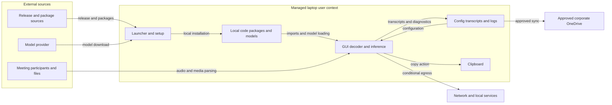

# Meeting Scribe threat model

Reviewed 2026-10-12, branch `main`, commit `234bd5c874f4b41edf7ff046e50737007c61ffd6`. This is a threat model and targeted control review, not an exhaustive vulnerability scan.

## Executive summary

Meeting Scribe runs as the signed-in Windows user and processes confidential audio with Python and native libraries. Its strongest controls are local model loading, setup consent, embedded payload checksums, extraction containment, and atomic transcript writes. The highest priorities are package/release provenance and enforcing runtime egress outside the Python process: the socket guard does not constrain native networking or hostile code. Malicious media and model files also reach native parsers without process isolation. Unbounded live audio queues create a concrete availability risk. Approved corporate OneDrive storage is an accepted deployment condition, not a finding.

The rest of this report describes the code as reviewed at `234bd5c`. The next section records what has changed since then.

## Remediation status

Updated 2026-10-12 after the remediation commits listed below. The threat analysis in later sections is unchanged.

| Threat | Status | Fixed in the app | Still needs a control outside the app |
|---|---|---|---|
| TM-001 Supply-chain execution | Partly fixed | Every package, including dependencies, is locked to one version and SHA-256 in `resources/requirements.lock.txt` and `resources/requirements-openvino.lock.txt`. Setup installs with `--require-hashes --only-binary=:all: --no-deps` (`6402d6a`). The GPU trial path and its unpinned `onnxruntime-directml` requirement are removed (`9bd2eed`). The README publishes the launcher's SHA-256, and `.gitattributes` keeps the launcher bytes identical on every checkout. | The `.pyw` launcher is not code-signed: users must get it from an approved channel and check the checksum. Lock hashes record what PyPI served when the lock was made, so lock diffs need review. The PyInstaller build (`resources/requirements-build.txt`) is not hash-locked. |
| TM-002 Egress after compromise | Partly fixed | The Python guard also blocks UDP `sendto`/`sendmsg` to non-loopback hosts (`40d5bba`). `openvino-telemetry`, which OpenVINO declares but only its unused model converter imports, is left out of the lock and deleted from older installs; OpenVINO then uses its built-in no-op stub. The decoder child process runs with the guard, FFmpeg `protocol_whitelist=file`, and a job that forbids child processes (`5b281a7`). | Native code in the GUI process (CTranslate2, OpenVINO, PortAudio) is still outside the Python guard. Recommended: an outbound Windows Firewall or endpoint rule blocking `pythonw.exe` from the runtime folder after setup. |
| TM-003 Malicious native input | Fixed for media decoding | Saved recordings are decoded in a separate process (`app/audio_decode_worker.py`). Before it opens the file, the app places it in a Windows job with a 2 GB memory cap and no child processes, killed when the job closes. It accepts only an existing local file, uses FFmpeg's `protocol_whitelist=file`, and is stopped after 120 s without output. A crash becomes a normal error message. The picker no longer offers "All files" (`5b281a7`). | The decoder child is not a sandbox: it runs as the user and can read the user's files. AppContainer or low-integrity isolation would be the next step. Model files are still parsed in the GUI process; TM-004 digests cover setup-managed models. |
| TM-004 Model substitution | Fixed for setup-managed models | `resources/model_manifest.json` pins each model to a Hugging Face commit and lists every file's SHA-256. Setup downloads that commit, refuses and discards a download that does not match, and records the revision in `MODEL_SOURCE.json`. Installs made before this change are checked once and then recorded, or offered a re-download (`f3c2db7`). A model folder set under **Advanced** is logged as not verified. | Files are not re-hashed at every start, so the model folders need normal Windows permissions against other writers. |
| TM-005 Resource exhaustion | Fixed | The live transcription queue holds at most 30 minutes of untranscribed audio. Past that the oldest chunk is skipped and a warning is shown, so the recorder never blocks. The recorder hand-off queue holds 8 chunks (`40d5bba`). The decoder child is capped at 2 GB (`5b281a7`). | Transcript text for one session stays in memory (small). Native inference calls have no hard deadline. |
| TM-006 Unintended disclosure | Accepted, no change | Logs never contain transcript text. Copy happens only on an explicit button press. | OneDrive sharing, retention and clipboard or DLP policy. |
| TM-007 Destination misuse | Accepted, no change | The save dialog confirms overwrites, live sessions use timestamped file names, and writes are atomic. | Normal Windows permissions on the install and config folders. |

Recommended IT controls, in priority order:

1. Distribute the launcher through an approved channel and publish its SHA-256 alongside it.
2. Add an outbound firewall or endpoint rule that blocks the runtime `pythonw.exe` once setup has finished.
3. Keep the install folder writable only by its user.
4. Apply OneDrive sharing and DLP policy to the transcripts folder.

## Scope and assumptions

- **Confirmed by the user:** managed company laptops only; OneDrive is the only expected synced location and is already approved for confidential information; malicious meeting files and compromised dependencies/models are in scope.
- **In scope:** `app/`, `resources/`, both generated `.pyw` launchers, and `packaging/`. The primary workflow is the Python desktop launcher; the documented PyInstaller bundle is a secondary distribution path.
- **Assumptions:** a single signed-in user, standard Windows privileges, confidential meeting contents, and company-managed account/device protection. The application exposes no intended remote API or server.
- **Out of scope:** Windows/OneDrive internals, enterprise identity configuration, GPU driver exploitation, participant consent policy, and a comprehensive dependency CVE audit. Tests provide evidence but are not deployed services. No CI workflow was found in the repository file inventory.
- **Open questions:** whether IT already enforces process-level outbound rules; how launchers, wheels, and model revisions are approved; the actual OneDrive sharing/retention and Windows directory permissions. These can lower or raise the conditional risks below.

## System model

### Primary components

- **Launcher/extraction:** the standalone launcher contains a compressed JSON payload, checks SHA-256 values, writes `app/` and `resources/`, and selects the installation root. It does not establish publisher authenticity. Evidence: `packaging/build_standalone_pyw.py:87`, `decode_payload`, `safe_payload_target`, `write_payload_file`, `main`; `tests/test_standalone_launcher.py`.
- **Setup:** Tkinter bootstrap checks local dependencies and models, installs packages with a `pip` subprocess after installation is requested, and downloads public Hugging Face snapshots. Intel GPU installations add OpenVINO packages. Evidence: `app/bootstrap_launcher.py`, `run_bootstrap`, `run_pip_install`, `download_snapshot_with_progress`, `GPU_TRIAL_BACKENDS`.
- **Runtime:** PySide6 GUI controls microphone/WASAPI capture, file transcription, model loading, output paths, and clipboard export. CPU inference uses faster-whisper/CTranslate2; Intel inference uses OpenVINO GenAI. Evidence: `app/meeting_transcriber_gui.py`, `MainWindow`; `app/transcriber_engine.py`, `MeetingTranscriberEngine`, `OpenVinoWhisperModel`, `_create_whisper_model`.
- **Local persistence:** JSON configuration, model files and GPU compilation cache, plaintext transcripts/recovery files, and diagnostic logs. Installed packages move outside OneDrive when the installation root is synced; transcripts and models do not receive that relocation. Evidence: `app/app_config.py`; `app/bootstrap_launcher.py:1140`, `local_runtime_dir`; `app/transcriber_engine.py`, `AtomicTranscriptWriter`, `_create_pipeline`.
- **Build tooling:** standalone generator and optional PowerShell/PyInstaller build consume the source and package requirements. Evidence: `packaging/build_standalone_pyw.py`; `packaging/build_portable.ps1`; `packaging/local_whisper_transcriber.spec`; `resources/requirements-build.txt`.

### Data flows and trust boundaries

- **B1 — Distribution/source to launcher/build:** executable Python, embedded resources, wheels, and native libraries cross a file/distribution boundary. Embedded hashes detect inconsistent content; the attacker can replace both content and hashes if the launcher itself is untrusted. No independent release signature verification is implemented. Relevant threats: TM-001, TM-004.
- **B2 — Package/model providers to setup:** packages, model data, and repository metadata cross HTTPS into the local runtime/staging folders. TLS uses Windows/corporate trust and optional local CA bundles. Direct package versions are pinned; package artifact hashes, complete transitive pins, and model commit revisions are absent. Hugging Face download calls use `token=False`; staged models are checked and rolled back on replacement failure. Evidence: `resources/requirements.txt`; `app/bootstrap_launcher.py:1481`, `configure_download_tls`, `download_snapshot_with_progress`, `copy_staged_model_to_target`. Relevant threats: TM-001, TM-004.
- **B3 — Recording/participants to decoder and inference:** selected file bytes or microphone/system audio enter the application through local files and audio APIs. The file dialog includes `All files`; PyAV performs content parsing. A worker thread is not a security sandbox. Model completeness and capture settings are validated, but decoder resource limits and process isolation are absent. Evidence: `app/file_transcriber.py:101`, `audio_chunks`; `app/meeting_transcriber_gui.py`, `MEETING_FILE_FILTER`; `app/transcriber_engine.py`, `EngineConfig.validate`. Relevant threats: TM-003, TM-005.
- **B4 — Local models/config/packages to runtime:** files and environment settings determine imports, model loading, compute settings, and destinations. Configuration accepts recognized keys and checks basic types; model checks primarily establish required-file presence. OS permissions supply the access boundary. Evidence: `app/app_config.py`, `load_portable_config_safely`; `app/transcriber_engine.py:38`, `_create_whisper_model`; `app/bootstrap_launcher.py:1940`. Relevant threats: TM-001, TM-004, TM-007.
- **B5 — Runtime to network/local services:** offline environment flags and Python socket hooks block ordinary external Python TCP connections/DNS; loopback remains allowed. Native libraries, subprocesses, and `sendto` are outside these hooks. No production listener was found. Evidence: `app/offline_guard.py:86`; `app/bootstrap_launcher.py:1923`. Relevant threat: TM-002.
- **B6 — Runtime to storage/clipboard/approved OneDrive:** transcript text crosses filesystem and clipboard APIs; OneDrive independently synchronizes approved folders. Atomic replacement protects against partial writes, not unauthorized readers or sharing mistakes. Source/output equality is rejected for file jobs. Evidence: `app/transcriber_engine.py:593`; `app/app_config.py`, `append_error_log`; `app/meeting_transcriber_gui.py:733`. Relevant threats: TM-006, TM-007.

#### Diagram

## Assets and security objectives

| Asset | Why it matters | Security objective (C/I/A) |
|---|---|---|
| Audio buffers, recordings, transcripts, recovery files | Confidential meeting contents and participants | C/I |
| User account context and accessible company files | Compromised code inherits the user's access | C/I |
| Launcher, packages, models, configuration, GPU cache | Determine executable behavior, output correctness, and destinations | I |
| CPU/GPU, RAM, disk, and capture continuity | Transcription must not exhaust resources needed by meetings | A |
| Logs and clipboard contents | Can reveal meeting context, paths, and copied transcript text | C/I |
| Approved OneDrive copies and sharing settings | Preserve authorized access and company retention expectations | C/I/A |

## Attacker model

### Capabilities

- Send a malicious recording that the user chooses to open, or supply audio through a meeting.
- Compromise an upstream package/release/model account or artifact source; induce installation or upgrade of that content.
- Conditionally alter files in a shared/synced installation or model folder if granted write access. A transcript-only reader does not thereby gain package access.
- After code execution, use the signed-in user's filesystem, clipboard, native APIs, and permitted network access.

### Non-capabilities

- No assumed unauthenticated remote endpoint, administrator rights, kernel compromise, or access to arbitrary company OneDrive folders.
- No assumed filesystem/configuration control from recording bytes alone.
- No assumption that model weights inherently execute Python, or that a particular installed decoder has an exploitable vulnerability.
- The Python offline guard is a behavioral safeguard, not containment for malicious code. Same-user malware already has broad access; this model does not label that as privilege escalation.

## Entry points and attack surfaces

| Surface | How reached | Trust boundary | Notes | Evidence (repo path / symbol) |
|---|---|---|---|---|
| Standalone launchers and install root argument | Double-click or CLI | B1/B4 | Executable distribution and user-selected destination | `packaging/build_standalone_pyw.py`, `main`, `parse_args` |
| Package installation and dependency probe | Setup/check on launch | B2/B4 | Subprocesses inherit environment; downloaded code is trusted at import | `app/bootstrap_launcher.py`, `run_pip_install`, `missing_runtime_imports` |
| TLS trust inputs | Setup environment or neighboring CA files | B2 | Local CA discovery expands trust; requires protected source locations | `app/bootstrap_launcher.py`, `find_local_ca_bundle` |
| Model download, custom model path, compilation cache | Setup or Advanced settings/config | B2/B4 | Completeness is not provenance | `app/bootstrap_launcher.py`, `download_default_models`; `app/transcriber_engine.py`, `_create_pipeline` |
| Saved recording decoder | GUI file selection | B3 | Native parsing, including All files selection | `app/file_transcriber.py`, `FileTranscriptionWorker.run` |
| Live microphone and system audio | Record action | B3 | Long sessions and slow inference can accumulate queued audio | `app/transcriber_engine.py`, `_recording_loop`, `_fanout_loop` |
| Configuration and environment paths | Local files/process environment | B4/B6 | Operator-controlled unless folder/environment access is compromised | `app/app_config.py`, `load_portable_config`, `error_log_root` |
| Transcript/recovery output, errors, clipboard | Runtime save/copy | B6 | Plaintext, inherited filesystem/account controls | `app/transcriber_engine.py`, `AtomicTranscriptWriter`; `app/meeting_transcriber_gui.py`, `_copy_transcript` |
| Build scripts and wheelhouse | Developer/operator invocation | B1/B2 | Separate from normal runtime; no automatic remote trigger | `packaging/build_portable.ps1`; `resources/requirements-build.txt` |

## Top abuse paths

1. **TM-001 — Supply-chain execution:** compromise a release or eligible dependency artifact; the operator launches/installs it; Python/native imports run attacker code with the user's access to company data.
2. **TM-002 — Egress after compromise:** obtain execution through TM-001 or a parser vulnerability; read confidential buffers/files; use native networking, a subprocess, or unhooked UDP to bypass the Python-only policy. Exfiltration is conditional on outbound endpoint controls.
3. **TM-003 — Malicious native input:** send crafted media or model parser input; the user selects it; a vulnerability, if present, executes code or crashes the shared GUI process. No such vulnerability was established in this review.
4. **TM-004 — Model substitution:** compromise a model source or obtain model-directory write access; replace a complete-looking model/configuration; the local loader accepts it, altering transcript integrity or consuming excess resources. Parser exploitation is a separate conditional path.
5. **TM-005 — Resource exhaustion:** keep live recording active while inference is slower than capture, or supply pathological/very long media; queued audio, transcript rows, or native decode work accumulate; the application loses responsiveness or harms meeting availability.
6. **TM-006 — Unintended disclosure:** an operator copies a transcript or shares a folder too broadly; an unauthorized recipient/clipboard consumer reads it. This is residual workflow risk, not evidence that approved OneDrive is unsuitable.
7. **TM-007 — Destination misuse:** obtain config or destination-directory write access; redirect transcript output to another user-writable file or disrupt its path; atomic replacement overwrites that target or fails saving. Existing permissions limit the impact; this is not an elevation of privilege.

## Threat model table

| Threat ID | Threat source | Prerequisites | Threat action | Impact | Impacted assets | Existing controls (evidence) | Gaps | Recommended mitigations | Detection ideas | Likelihood | Impact severity | Priority |
|---|---|---|---|---|---|---|---|---|---|---|---|---|
| TM-001 | Compromised release/package source | User launches or installs affected content. | Replace code or an eligible dependency artifact. | User-context execution and data theft. | Company data, code, transcripts | Direct version pins (`resources/requirements.txt`); payload checksums (`decode_payload`); TLS (`configure_download_tls`). | No independent launcher authenticity; no full dependency hash lock; transitive versions float; pip source builds allowed. | Approve/sign release manifests; lock every dependency and wheel hash; use an approved wheelhouse with `--require-hashes --only-binary=:all:`; verify selected artifact provenance; restrict setup index/environment settings. | Record approved artifact hashes and package inventory; alert on unexpected module origins and child processes through endpoint tools. | medium: installation is routine, but upstream/release compromise is required. | high: execution inherits confidential data access. | high |
| TM-002 | Malicious dependency or compromised process | Code execution or a native networking path; outbound traffic permitted. | Bypass Python socket hooks. | Runtime confidentiality/offline objective fails. | Audio, transcripts, user-accessible data | Offline flags and TCP/DNS hooks (`offline_guard.install_socket_guard`); local model loading (`_create_whisper_model`). | Native APIs, subprocesses and UDP `sendto` unhooked; hostile code can remove hooks. | Enforce runtime egress with IT-managed OS/process isolation that covers descendants and native APIs; separate online setup from runtime; restrict decoder protocols as defense in depth; document Python guard limits. | Endpoint outbound/child-process events; expected offline runtime should produce no external egress. | medium, conditional: bypass is verified, but abuse needs the stated prerequisite. | high: sensitive data can leave approved boundaries. | high |
| TM-003 | Sender of malicious media/model bytes | User loads crafted input and a relevant parser vulnerability exists. | Exploit native FFmpeg/CTranslate2/OpenVINO parsing. | User-context execution or process crash. | Company data, availability | Local selection, settings/file completeness checks (`FileTranscriptionWorker.run`, `EngineConfig.validate`); standard user deployment. | Decode/inference run in GUI process; no parser sandbox. | Move untrusted decode/model loading into a constrained process; restrict filesystem/network access and supported demuxers; maintain reviewed native dependency updates. | Worker crashes/timeouts and endpoint exploit alerts; preserve file hashes rather than contents in diagnostics. | low: no exploitable parser defect was demonstrated. | high: a successful exploit inherits user access. | medium |
| TM-004 | Compromised model provider or writable model folder | Malicious upstream revision or model-directory write access. | Substitute weights/tokenizer/config/cache. | Transcript integrity loss, unreliable inference or availability loss. | Model state, transcripts, compute | Public repository IDs, `token=False`, staging/rollback (`download_snapshot_with_progress`, `copy_staged_model_to_target`); completeness checks. | No immutable revision or independently approved digest; `MODEL_SOURCE.json` stores only repo ID. | Pin model commit revisions; validate files against an approved digest manifest; record revision with source metadata; protect model/cache directories; make custom model trust explicit. | Log approved revision/digest mismatch and unexpected model changes. | low: requires source compromise or write access. | high: systematic corruption can affect confidential meeting records. | medium |
| TM-005 | Malicious input sender, meeting participant, or adverse workload | Long sessions, slow inference, or costly native input. | Accumulate audio/transcripts or monopolize decode work. | RAM/CPU exhaustion and lost meeting continuity. | Availability, unsaved work | Callback queue limited to 64 blocks (`InputBlockBuffer`); file decoding uses windows (`audio_chunks`); cancellation and lag status exist. | Both live chunk queues have no `maxsize`; `max_queue_chunks` is not used to bound them; transcript storage grows; native calls have no hard deadline. | Bound live queues using validated limits and an explicit drop/stop policy; cap supported recording/workload sizes; put decode/inference under process memory/time limits; checkpoint transcript history. | Queue depth, oldest-chunk age, memory and worker deadline events. | medium: slow live inference can occur without an attacker. | medium: impacts this laptop/session, not a shared service. | medium |
| TM-006 | Unauthorized recipient or clipboard consumer | Overbroad sharing, wrong destination, or accessible clipboard history. | Read plaintext exported contents. | Confidential meeting disclosure. | Transcripts, recovery files, clipboard, contextual logs | Approved corporate OneDrive per user; explicit Copy action; OS access boundary; plain transcript insertion (`_append_transcript`). | No app retention/sharing enforcement; clipboard export persists according to OS policy. | Use approved company access/clipboard policies; keep recoveries and logs within approved destinations; minimize sensitive diagnostic values; show actual save/recovery destinations. | Enterprise sharing audits and data-loss prevention controls. | low under confirmed approved-storage context; permissions were not independently checked. | high for confidential contents. | low |
| TM-007 | Config/directory writer or operator mistake | Control of configuration/destination or deliberate save selection. | Redirect or disrupt file replacement. | Overwrite a user-writable file or lose output. | Local files, transcript integrity | Source/output equality rejected; timestamped live paths; secure temp creation and atomic replacement (`AtomicTranscriptWriter`, `session_output_path`). | Destination is unrestricted and trusted; directory permissions/reparse-point behavior not enforced by app. | Treat destination as operator authority; validate approved storage where company policy requires it; protect installation/config directories; retain overwrite confirmation and explicit recovery reporting. | Config/destination change records without transcript contents; save/recovery failures. | low: requires existing write access or operator error. | medium: limited to existing user permissions. | low |

## Criticality calibration

- **critical:** a demonstrated reliable code-execution path from an ordinarily selected recording without prior local compromise; a proven widely distributed malicious update causing company-wide credential/data theft. Neither was established here.
- **high:** compromised installed packages execute with company-data access (TM-001); executable compromise can exfiltrate through an unenforced runtime egress boundary (TM-002). Priority assumes missing independent IT controls.
- **medium:** plausible native parser exploitation without a demonstrated defect (TM-003); model integrity compromise (TM-004); live workload exhausts one laptop (TM-005).
- **low:** sharing/clipboard exposure under an approved storage regime (TM-006); output misuse requiring existing config/write authority (TM-007). Approval of OneDrive alone is not evidence of either exploit.

## Focus paths for security review

| Path | Why it matters | Related Threat IDs |
|---|---|---|
| `app/offline_guard.py` | Python hooks are not a native/process security boundary. | TM-002 |
| `app/bootstrap_launcher.py` | Setup trust, CA discovery, dependency imports, model provenance, and online/offline transition. | TM-001, TM-002, TM-004 |
| `resources/requirements.txt` | Direct pins lack a complete hash-verified dependency closure. | TM-001, TM-003 |
| `app/file_transcriber.py` | Untrusted native decoding, cancellation, and incremental output. | TM-002, TM-003, TM-005, TM-007 |
| `app/transcriber_engine.py` | Model loaders/cache, unbounded live queues, plaintext and atomic writes. | TM-003, TM-004, TM-005, TM-007 |
| `app/app_config.py` | Trust in configuration/environment and destinations; diagnostic persistence. | TM-006, TM-007 |
| `app/meeting_transcriber_gui.py` | All-files selection, capture modes, actual save path, and clipboard export. | TM-003, TM-005, TM-006, TM-007 |
| `packaging/build_standalone_pyw.py` | Extraction containment and checksum versus publisher-authentication guarantees. | TM-001 |
| `Open Offline Meeting Transcriber.pyw` and `Open Offline Meeting Transcriber GPU Trial.pyw` | Distributed executable payloads must match reviewed source and approved release provenance. | TM-001 |
| `packaging/build_portable.ps1` and `packaging/local_whisper_transcriber.spec` | Developer-controlled build inputs, wheelhouse trust, and unsigned bundle distribution. | TM-001 |

## Notes on use

**Verification:** 7 offline-guard tests and 16 standalone-launcher tests passed under Python 3.12. They verify intended Python TCP/DNS behavior and launcher integrity/containment; they do not establish sandboxing or publisher authenticity.

An isolated, temporary, loopback-only test with installed PyAV **18.0.0** replaced the guard's address check with a rule rejecting all Python connections, including loopback. `socket.create_connection` was rejected, while `av.open` of a direct loopback HTTP WAV successfully made a native HTTP request and found one audio stream. `socket.socket.sendto` was also unchanged after guard installation. No confidential files or external destinations were involved. This verifies a control coverage gap, **not** a remotely reachable exploit: the current file worker converts its input to `Path`, and the tested local HLS playlists produced `InvalidDataError` without HTTP requests. No working malicious-file network-fetch path was established.

For decoder defense in depth, evaluate `options={"protocol_whitelist": "file"}` with supported formats and a restricted demuxer set, and reject nonlocal paths where required. Native library protocol restrictions supplement, but cannot replace, OS containment for hostile code. FFmpeg documents protocol allowlists and default nested-protocol restrictions; PyAV exposes options through `av.open`. [FFmpeg protocol options](https://ffmpeg.org/ffmpeg-protocols.html#Protocol-Options), [PyAV opening options](https://pyav.org/docs/stable/api/_globals.html).

Package hardening should pin and hash the complete dependency set, including GPU requirements. The pip documentation supports hash enforcement and disabling source distributions; hashes must come from an approved process, since hashing already compromised artifacts does not establish trust. [pip secure installs](https://pip.pypa.io/en/stable/topics/secure-installs/).

Quality check:

- [x] Discovered launcher, setup, model/config, capture, file, output/clipboard, and build entry points covered.
- [x] B1–B6 mapped to threats; no unintended remote server invented.
- [x] Runtime distinguished from build/dev and tests.
- [x] User's managed-laptop, approved-OneDrive, and malicious-input/source scope incorporated.
- [x] Existing controls separated from proposed controls; conditional threats and unverified exploit prerequisites explicit.
- [x] Remaining IT egress, provenance, sharing/permissions, and retention questions documented.

Only this report was added. Application code, dependencies, configuration, and distribution artifacts were not changed.
